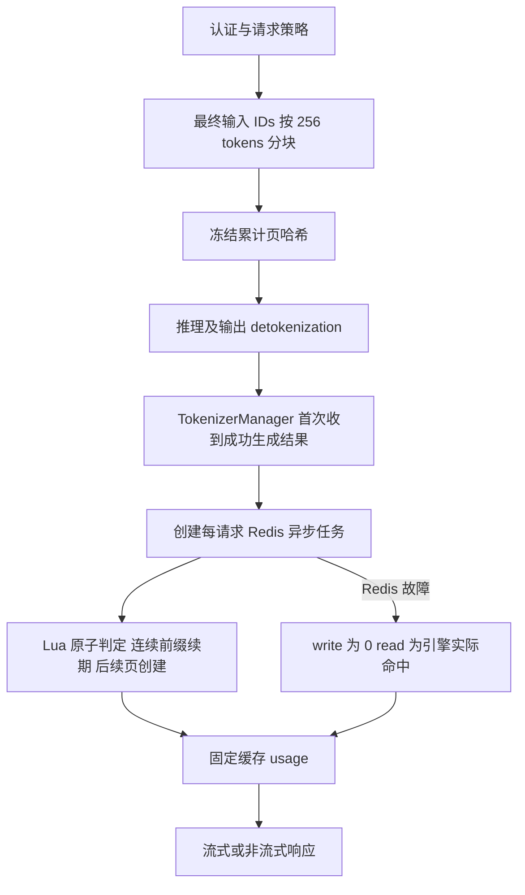

# Redis 页级缓存计量框架评审稿

实现分支为 `liuhe/cache_write`，基于 `zq/v0.5.21-video-image-cpupre-nodemotion`。输入 tokenization 完成后准备页哈希；首次收到成功生成结果时执行 Redis 原子计量；每请求的异步响应任务等待结果后返回 usage。功能默认关闭，引擎原有缓存指标保留在内部元数据中。PD 模式只在 Decode 侧统计，Prefill 沿用原有推理流程。

## 用户规则

- 用户身份来自 `Authorization: Bearer` 中已验证的 API key，Redis 是唯一在线记录存储。
- TTL 有 5min、1h 两档，**TTL 属于缓存身份**。同一用户、同一输入的两档记录互不命中，分别续期。
- 5min 请求只读取并续期 5min 记录，1h 请求只读取并续期 1h 记录；本档没有记录时，即使另一档存在也按本档 write 处理。
- 有效记录命中后按该档时长续期；成功创建记录计 write，读取有效记录计 read。
- 每块固定 256 tokens，尾部不足 256 的 token 计普通输入。
- Redis 故障时，本次 write 为 0，read 使用引擎本次实际缓存命中量。

## 数据和页边界

计量块大小固定为 `CACHE_BLOCK_SIZE = 256`，独立于推理引擎的 KV page-size；不修改引擎页大小，也不增加缓存页数上限。输入长度沿用引擎现有校验。框架暂不开放 DCP。

最终送给模型的输入 IDs 按 256 个 token 切成完整页，最后不足 256 个的尾部不写 Redis。namespace 包含部署标识、模型、权重版本、tokenizer 和模板信息。每页使用固定 uint32 大端编码和累计 SHA256；用户身份、namespace、块大小和 TTL 都参与 seed。

```text
seed = hash(domain, api_key_hash, namespace, 256, ttl_seconds)
hash_0 = hash(seed, tokens[0:256])
hash_1 = hash(hash_0, tokens[256:512])
...
```

相同页内容出现在不同历史前缀下，得到不同哈希。没有 decode 成文本、逐消息单独编码或重 hash 所有历史，避免边界偏差及平方复杂度。

Redis String key 使用如下格式：

```text
sglang:cache:v1:{FIRST_PAGE_DIGEST}:page:PAGE_DIGEST
```

同一输入前缀的所有页同槽；不同首个页可分散到不同槽。当前客户端连接普通 Redis endpoint，不处理 Cluster MOVED 路由；同槽布局为后续集群客户端保留条件。

## read 和 write 的计算

只读取从输入开头起连续存在的最长完整页前缀。第一次缺页之后，即便后面存在孤立记录，所有后续完整页仍按创建处理。续期命中页并写入后续页，在一段 Lua 中原子完成。

例：当前输入 800 tokens，共 3 个完整页和 32 个尾部 token。

| Redis 状态 | read | write | 普通输入 |
| --- | ---: | ---: | ---: |
| 无记录 | 0 | 768 | 32 |
| 连续命中前两页 | 512 | 256 | 32 |
| 三页全命中 | 768 | 0 | 32 |
| 第1页存在、第2页缺失、第3页存在 | 256 | 512 | 32 |

始终满足 `read + write_5m + write_1h + normal = prompt_tokens`。例如 5m 已缓存，不代表相同输入的 1h 请求命中。两档独立创建和续期，不跨档读取或继承 TTL；这以本项目的隔离规则为准。

此模式支持页边界上的输入前缀扩展：原请求写入的完整页可以被后续更长请求读取，新增完整页计 write，尾部计普通输入。当前不解析消息块级缓存断点，缓存范围为整个实际输入中的完整页。

## decode 输出阶段的执行



Redis I/O 不放进 GPU scheduler，也不在共享批次接收循环中逐请求 await。共享接收循环只创建任务；每个请求的响应生成器等待自己的任务，其他请求仍能接收后续输出。

只有 completion_tokens 大于 0 且不是 abort/error 的输出才触发。生成 EOS、没有可见文本，也可以计量。每个请求只调用 store 一次，之后每个输出 chunk 复用快照。客户端等待被取消时，不取消已经启动的原子操作；已建立记录可被后续请求读取。

缓存判定时点是首次成功输出到达管理层，TTL 从 Lua 执行时起算。不同请求按 Redis 实际执行顺序分类。

创建发生在成功输出之后，Lua 在一次操作中判定并建立缓存记录。

## 并发和失败

Lua 先验证所有参数和 key 类型，然后读取最长连续前缀，再统一续期或创建。原子执行防止同批冷启动把同一页重复算成首次创建。脚本处理全部完整的 256-token 页，所有 key 显式通过 KEYS 传入，不进行 SCAN。

每个请求只启动一次 Redis 计量任务，流式后续 chunk 复用本请求内存中的固定结果。Redis 只保存缓存页记录。新请求按 Redis 当时的页面状态重新判定 read/write。

Redis 连接、执行超时或结果不确定时，按业务约定降级：两个档位 write 都为 0，read 取首次成功输出携带的引擎实际 `cached_tokens`，普通输入为 `prompt_tokens - read`。物理命中量不按 256 取整，取值限制在 0 到完整输入数之间。该结果在请求内冻结，后续分片不重新分类，初始响应头和尾部 usage 使用同一结果。未开启缓存的请求保留原路径。

如果 Redis 已执行但响应丢失，本次仍报 write 0；已经建立的条目可能被后续请求命中。最终输入 IDs 与引擎输入数量不一致属于内部一致性错误，仍拒绝生成不一致的 usage。

Redis 调用失败后不自动重试，后续 chunk 也不会重新发起计量。

## 身份与版本

客户端使用 `Authorization: Bearer API_KEY` 传入凭据，沿用 Router 已有的认证头透传和服务端普通/管理接口权限规则。不新增自定义身份 header。未经校验的 header 不能成为缓存身份。

认证成功后，API 从 `request.state.api_key` 获取内部缓存身份，其值为 `api-key:` 加已验证凭据的 SHA256 摘要。`GenerateReqInput.api_key` 和页哈希函数的参数也统一使用 `api_key` 命名；这些内部字段保存摘要，不保存原始密钥。共享一个服务 API key 的调用方属于同一缓存身份。多租户网关可通过可信认证中间件预填该 state；请求体 `user`、`api_key` 或未验证的 header 不会成为认证依据。

原生 `/generate` 在 HTTP 入口也强制使用认证 state 覆盖 body 的 `api_key` 字段，避免绕过 chat 层。进程内 Engine 调用属于可信调用方，需要显式提供内部 `api_key` 身份和 TTL。

`--cache-namespace` 用于隔离 Redis 缓存记录。缓存功能不额外限制在线权重更新、权重版本修改或 checkpoint-engine 等待后注入权重，这些操作沿用引擎原有流程。每个请求在准备页哈希时读取当时的 namespace 信息，并在本请求内固定使用。

## 请求和响应

启用后，OpenAI chat 和 Anthropic messages 引擎入口接受顶层控制。这里使用的 Router 是 `experimental/sgl-router`，它保留并透传 OpenAI chat 请求中的 `prompt_cache_options`，请求格式不改为 metadata：

这个 Router 接收原始请求体，只提取路由和采样所需字段；注入 input IDs、采样默认值、请求 ID 和 PD bootstrap 时，保留完整 JSON 中的其余字段。顶层缓存选项沿用这条路径透传。PD 同时传给 P 和 D；P 的请求仅关闭流式输出，缓存选项保持原样。省略选项或 TTL 时，默认 5 分钟由 D 侧引擎处理，Router 保留请求中原有的省略状态。

`Authorization` 已在请求头透传白名单中。普通 JSON 响应和 SSE 流式响应都沿用 D 的原始响应内容，其中包含 `cached_tokens` 和 `cache_write_tokens`。成功响应额外透传 D 返回的两档写入响应头；采用精确白名单，不合并 P 的写入量，也不转发其他上游私有响应头。

OpenAI chat 使用标准路径 `POST /v1/chat/completions`。

请求头示例：

```http
Content-Type: application/json
Authorization: Bearer API_KEY
```

```json
{
  "model": "MODEL_NAME",
  "max_tokens": 128,
  "prompt_cache_options": {"mode": "implicit", "ttl": "1h"},
  "messages": [{"role": "user", "content": "需要重复使用的输入"}]
}
```

请求使用 `prompt_cache_options`，`mode` 当前只支持 `implicit`，表示按完整输入页隐式处理缓存；省略 `mode` 时也取 `implicit`。`ttl` 只接受 `5m` 或 `1h`，省略时默认 `5m`（300 秒）；`1h` 为 3600 秒。比如 `{"prompt_cache_options": {"mode": "implicit"}}` 使用 5 分钟缓存。非法 mode 或 TTL 拒绝；功能关闭时显式要求缓存会返回参数错误。

服务开启本功能后，整个 `prompt_cache_options` 不传也默认使用 `implicit`、5 分钟缓存，仍须提供可信认证身份；只有显式指定 `ttl: "1h"` 才进入 1 小时档位。请求策略如下：

| 请求中的选项 | 缓存策略 |
| --- | --- |
| 不传 `prompt_cache_options` | implicit，5 分钟 |
| `{"mode": "implicit"}` | implicit，5 分钟 |
| `{"mode": "implicit", "ttl": "5m"}` | implicit，5 分钟 |
| `{"mode": "implicit", "ttl": "1h"}` | implicit，1 小时 |

服务没有开启本功能时，不传选项的请求沿用原有处理流程。

PD 模式下，Prefill 收到 `prompt_cache_options` 也直接忽略这份缓存计量，不因本功能未开启而拒绝请求；Decode 执行一次 Redis 统计并返回 usage。这样同一请求不会先在 P 算 write、随后又在 D 算 read。目标分支原有 CPU 预处理子进程仍使用已验证的身份摘要，不传入新的原始密钥字段。

OpenAI usage 中，`prompt_tokens` 始终是完整输入数；使用本功能时，`prompt_tokens_details.cached_tokens` 表示本次缓存读取量，`cache_write_tokens` 表示本次写入量。正常使用 Redis 的计量结果；Redis 故障时使用前述物理读取降级结果。返回格式如下：

```json
{
  "usage": {
    "prompt_tokens": 1000,
    "completion_tokens": 100,
    "total_tokens": 1100,
    "prompt_tokens_details": {
      "cached_tokens": 200,
      "cache_write_tokens": 700
    }
  }
}
```

这个例子仅展示协议字段，普通输入为 `1000 - 200 - 700 = 100`，不单独增加公开字段。正常 Redis 计量的 read/write 按 256 对齐，普通输入为不足一页的尾部；Redis 故障时 read 使用未取整的物理命中。输出 token 不参与本次输入缓存计量。内部快照不序列化为公开的 `usage.cache_usage`，即使请求 `return_meta_info` 也不会在 choice 的元数据中暴露它。

服务开启本功能后，即使 read/write 都为 0，也显式返回这两个计数，不依赖旧的 `--enable-cache-report`。服务关闭本功能时，保持原有缓存报告行为，不增加 `cache_write_tokens`。

成功响应的初始 HTTP 首部包含以下两项，非流式和 SSE 使用相同名称；值为该请求实际写入的非负整数，没有写入的档位明确报 0：

```http
Msh-Usage-Cache-Write-Tokens-5m: 0
Msh-Usage-Cache-Write-Tokens-1h: 256
```

两个头的数值之和等于 `cache_write_tokens`。全命中、仅续期和 Redis 故障时两个头均为 0。头从冻结的计量结果产生，不根据请求 TTL 推测写入量；CORS 暴露这两个响应头供浏览器读取。

OpenAI 流式请求设置 `"stream": true` 和 `"stream_options": {"include_usage": true}`，在 `[DONE]` 前返回 `choices: []` 的完整 usage chunk，包含完整输入、输出、总量和缓存分项。HTTP 首部在发送首事件前根据同一快照设置；`include_usage=false` 时也有两个写入头。设置 `continuous_usage_stats` 时，中间事件携带相同的输入计量快照，不重复累加。

Anthropic usage 继续将内部快照映射为以下格式，以前文 800 个输入 token、命中两页的 5m 请求为例：

```json
{
  "input_tokens": 32,
  "cache_read_input_tokens": 512,
  "cache_creation_input_tokens": 256,
  "cache_creation": {
    "ephemeral_5m_input_tokens": 256,
    "ephemeral_1h_input_tokens": 0
  },
  "output_tokens": 128
}
```

上例总输入为 800。流式 message_start 携带同一份输入快照，后续不重复累加。空 completion 的初始 role 事件也携带快照。Anthropic 流式适配器通过 OpenAI 的公开 read/write 计数和请求所选 TTL 恢复创建分档。本次新增 HTTP 写入头的接口范围为 OpenAI Chat Completions。

## 启用与评审入口

运行环境安装可选 Redis 客户端：

```bash
pip install -e './python[cache-accounting]'
python -m sglang.launch_server \
  --model-path MODEL_PATH \
  --api-key API_KEY \
  --enable-cache-accounting \
  --cache-redis-url redis://127.0.0.1:6379/0 \
  --cache-namespace MODEL_WEIGHT_AND_TOKENIZER_REVISION
```

上述缓存参数用于单体引擎或现有 Decode 启动命令。PD 部署保留各自原有参数，在 D 侧开启 `--enable-cache-accounting` 并配置 Redis，P 侧不需要开启。D 侧需配置能校验 Router 转发 Bearer 凭据的 `--api-key`，才能生成可信身份摘要；未接入可信认证时，D 侧缓存请求会拒绝。计量始终按 256 tokens 分块。

Redis URL 不接受凭证、query 或 fragment，避免凭证出现在启动参数日志和 server_info。需要 Redis 认证时，通过 `SGLANG_CACHE_REDIS_USERNAME`、`SGLANG_CACHE_REDIS_PASSWORD` 环境变量提供。

| 新配置 | 默认 |
| --- | --- |
| enable_cache_accounting | false |
| cache_redis_url | 未设置，启用时必填 |
| cache_namespace | 未设置，启用时必填 |
| cache_timeout | 0.2 秒 |

例如输入 1000 tokens，无论引擎 KV page-size 是 1 还是 16，均有 3 个完整计量块、共 768 tokens；尾部 232 tokens 计普通输入。页数由输入长度自然决定，不要求额外的缓存页数配置。

主要代码：

- [页哈希和 Redis Lua store](python/sglang/srt/cache_accounting/page_cache.py)
- [输入准备及首次输出计量](python/sglang/srt/managers/tokenizer_manager.py)
- [配置与 CLI 字段](python/sglang/srt/arg_groups/fields/serving.py)
- [身份映射](python/sglang/srt/utils/auth.py)
- [Router 请求体准备与 PD 参数注入](experimental/sgl-router/src/server/routes/chat/preparation.rs)
- [PD 请求转发](experimental/sgl-router/src/server/routes/chat/forward.rs)
- [Router 请求入口](experimental/sgl-router/src/server/app.rs)
- [Router JSON 和 SSE 透传](experimental/sgl-router/src/proxy/mod.rs)
- [Router 缓存参数与 usage 透传测试](experimental/sgl-router/tests/proxy/prompt_cache_accounting.rs)
- [OpenAI usage 处理](python/sglang/srt/entrypoints/openai/usage_processor.py)
- [Anthropic usage 与流式入口](python/sglang/srt/entrypoints/anthropic/serving.py)

## 框架边界和测试

一期支持单请求、n=1、纯文本生成，含流式和非流式，以及 PD 模式下的 D 侧计量。多模态输入、input embedding、位置 embedding 覆盖、LoRA、会话重建和 beam 等尚未接入计量的请求，显式要求缓存时拒绝，默认隐式请求则跳过本功能；纯文本请求可在多模态模型上计量。DCP 和多 tokenizer worker 暂未开放。沿用引擎原有 KV 算法。

测试覆盖 256 边界、尾页、累计前缀、输入扩展、中间缺页、用户和版本隔离、TTL 两档隔离、续期及过期、并发首次创建、Redis 错误降级、首次输出仅计一次、EOS 空文本、取消、输入守恒、身份伪造、配置限制及两种协议的 usage。JSON/SSE 响应头与 usage 的一致性、零写入和无 include_usage 的 SSE 单独覆盖。Redis Lua 集成测试使用真实 Redis；TokenizerManager 方法采用 AST 载入隔离 GPU 依赖，协议及 usage 测试使用真实轻量模块。

Router 测试源码覆盖缓存选项在请求体改写后的保留，以及从 `/v1/chat/completions` 入口到 P/D worker 的参数、Bearer 和响应透传，包含普通和流式响应、两档写入响应头、零值及仅使用 D 响应头。TTL 默认值及非法参数由引擎入口测试覆盖。

在仓库根目录可以单独验证页哈希与 manager 计量边界；设置 `REDIS_SERVER_BIN` 后，第一条命令也会启动临时真实 Redis 验证 Lua：

```bash
python test/registered/unit/cache_accounting/test_page_cache.py -v
python test/registered/unit/test_cache_tokenizer.py -v
```

在安装好项目 Rust 工具链及构建依赖的环境中，从 `experimental/sgl-router` 目录执行 Router 测试：

```bash
cargo test --test proxy prompt_cache_accounting
```

本地已验证 Python/Redis 回归。本次 `experimental/sgl-router` 的 Rust 编译与测试按约定由评审方执行，当前没有运行。

本机未启动 GPU 模型服务，端到端推理、GPU 性能及实际部署流量下的 Redis 容量仍需部署环境验收。评审应重点看：以首次输出为计量时点是否符合业务、Redis 故障时物理读取降级是否符合口径、长输入下的 Redis 操作耗时，以及多租户身份后续如何接入。

参考：[Redis Lua 原子性与脚本约束](https://redis.io/docs/latest/develop/programmability/eval-intro/)。
